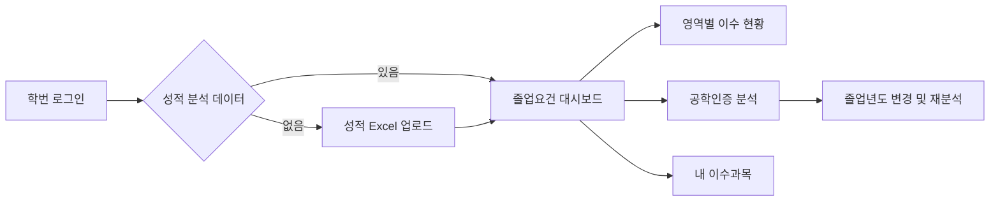

<div align="center">

# 세종대학교 졸업 인증 분석

**성적표 한 장에서 시작하는 졸업 준비.**

이수 학점, 졸업요건, 공학인증 현황을 한 화면에서 확인하는 해커톤 프로젝트입니다.

[](https://github.com/sejonghackathon/front/actions/workflows/ci.yml)


[주요 기능](#주요-기능) · [설계 포인트](#프론트엔드-설계-포인트) · [로컬 실행](#로컬-실행) · [기술 문서](docs/architecture.md)

</div>

## 프로젝트 소개

학생이 이수한 과목을 졸업요건과 공학인증 기준에 대조하고, 앞으로 채워야 할 항목을 파악할 수 있도록 돕습니다. 학사정보시스템에서 내려받은 성적 Excel을 업로드하면 백엔드 분석 결과를 학점 게이지, 영역별 과목 목록, 인증 상태로 보여줍니다.

이 저장소는 **프론트엔드**를 담고 있습니다. 로그인·성적 파싱·졸업요건 계산·ABEEK 판정은 별도 백엔드와 연동합니다. 현재는 해커톤 프로토타입이며, 일부 인증 카드는 목업이고 이수체계도는 구현 예정입니다.

## 주요 기능

| 기능 | 사용자 경험 | 구현 상태 |
| --- | --- | --- |
| 로그인 | 학번과 비밀번호 입력, 오류 안내, 로그인 상태에 따른 페이지 접근 제어 | API 연동 |
| 성적 업로드 | Excel 드래그 앤 드롭, 확장자·1MB 용량 검사, 업로드 결과 저장 | API 연동 |
| 졸업요건 대시보드 | 전체·전공 학점 진행률, 평균학점, 영역별 이수과목과 졸업작품 요건 확인 | API 연동 |
| 공학인증 분석 | 학과·입학년도·졸업년도 기준 ABEEK 결과, 부족 학점과 필수과목 확인 | API 연동 |
| 내 이수과목 | 업로드한 성적표 기반 이수 내역 확인 | 구현 |
| 고전독서·영어·SW 인증 | 인증 카드 레이아웃과 예시 내용 | 목업 · 실제 판정 아님 |
| 이수체계도·남은 과목 안내 | 후속 수강 계획 지원 | 구현 예정 |

### 이용 흐름



공학인증 분석에는 현재 학생의 성적표가 필요합니다. 브라우저에 성적표가 없으면 업로드 화면으로 안내합니다.

## 프론트엔드 설계 포인트

- **두 분석 서비스의 연결 분리** — 졸업요건 API와 ABEEK API 클라이언트를 분리하고, 개발 환경에서는 `/api`와 `/abeek` 프록시로 연결합니다.
- **학생별 성적표 구분** — Context와 localStorage로 성적표를 유지하며, 현재 로그인한 학생 ID와 일치하는 데이터만 화면에 사용합니다.
- **백엔드 계약의 타입 정의** — 학생 정보, 성적표, 졸업 진행도, 공학인증 결과를 TypeScript 인터페이스로 표현합니다.
- **과목 데이터 변환** — 성적표의 과목·학기 정보를 ABEEK 요청 형식으로 변환하고, 응답의 과목명 별칭을 이수 여부 표시에 반영합니다.
- **분석 결과의 시각화** — 재사용 가능한 SVG 게이지와 영역별 과목 목록으로 진행률을 표현하고, 긴 목록은 상세 다이얼로그로 제공합니다.
- **비동기 화면 상태 처리** — 로딩·오류·성적표 없음·지원하지 않는 학과를 구분하고, 화면 전환 후 이전 응답이 상태를 갱신하지 않도록 처리합니다.

구조와 API 연결 방식은 [기술 문서](docs/architecture.md)에 정리했습니다.

## 기술 스택

| 영역 | 사용 기술 |
| --- | --- |
| UI | React 19, TypeScript 6 |
| 개발·빌드 | Vite 8 |
| 라우팅 | React Router 7 |
| 스타일 | Tailwind CSS 4, shadcn/ui, Radix UI |
| 아이콘·알림 | Lucide React, Sonner |
| 상태·통신 | React Context, localStorage, Fetch API |
| 품질 확인 | ESLint, TypeScript, GitHub Actions |

## 로컬 실행

Node.js 24와 npm을 기준으로 합니다. Node 버전은 `.nvmrc`에 지정되어 있습니다.

```bash
git clone https://github.com/sejonghackathon/front.git
cd front
nvm use
npm ci
cp .env.example .env
npm run dev
```

브라우저에서 `http://localhost:5173`에 접속합니다. `nvm`을 사용하지 않는다면 Node.js 24를 직접 준비하면 됩니다.

**프론트엔드만 실행하면 로그인 화면을 확인할 수 있습니다.** 실제 로그인과 분석에는 아래 두 백엔드가 필요합니다. 이 저장소에는 백엔드 소스와 테스트 계정이 포함되어 있지 않습니다.

| 환경변수 | 기본값 | 용도 |
| --- | --- | --- |
| `VITE_API_PROXY_TARGET` | `http://localhost:8080` | 개발 서버의 졸업요건 `/api` 프록시 대상 |
| `VITE_ABEEK_PROXY_TARGET` | `http://localhost:8001` | 개발 서버의 `/abeek` 프록시 대상 |
| `VITE_API_BASE_URL` | 빈 문자열 | 졸업요건 API를 직접 호출할 때의 기준 URL |
| `VITE_ABEEK_API_BASE` | `/abeek` | 공학인증 API를 직접 호출할 때의 기준 URL |

기존 Docker 설정의 `VITE_PROXY_TARGET`도 졸업요건 프록시의 대체 변수로 지원합니다. 새 설정에서는 `VITE_API_PROXY_TARGET`을 우선 사용합니다. 환경변수를 변경한 뒤에는 개발 서버를 다시 시작하세요.

`.env`는 Git에 포함하지 않습니다. `VITE_` 접두사의 변수는 브라우저에 노출될 수 있으므로 비밀키를 넣지 않습니다.

### 명령어

| 명령어 | 설명 |
| --- | --- |
| `npm run dev` | 개발 서버 실행 |
| `npm run lint` | ESLint 검사 |
| `npm run build` | TypeScript 검사 후 `dist/` 빌드 |
| `npm run preview` | 빌드 결과 로컬 미리보기 |

### Docker 개발 환경

포함된 Dockerfile은 **Vite 개발 서버 실행용**입니다.

```bash
docker build -t sejong-graduation-front .
docker run --rm -p 5173:5173 \
  -e VITE_API_PROXY_TARGET=http://host.docker.internal:8080 \
  -e VITE_ABEEK_PROXY_TARGET=http://host.docker.internal:8001 \
  sejong-graduation-front
```

위 주소는 Docker Desktop에서 호스트의 백엔드에 연결하는 예시입니다. Compose에서는 각 백엔드 서비스 이름을 사용하세요. Linux 호스트에서는 별도 호스트 게이트웨이 설정이 필요할 수 있습니다.

배포 시에는 `dist/`를 정적 호스팅하고, SPA 경로를 `index.html`로 연결해야 합니다. Vite 개발 프록시는 빌드 결과에 포함되지 않으므로 `/api`·`/abeek` 리버스 프록시를 구성하거나 빌드 시 API 기준 URL을 지정합니다.

## 디렉터리 구조

```text
src/
├── assets/                 # 서비스 로고
├── components/
│   ├── layout/             # 대시보드 공통 레이아웃
│   ├── ui/                 # 공통 UI 컴포넌트
│   ├── CertificationTab.tsx # 공학인증 분석 화면
│   ├── Gauge.tsx           # 학점 진행률 게이지
│   └── RequireAuth.tsx     # 로그인 상태 기반 라우트 가드
├── lib/
│   ├── api.ts              # 로그인·성적표·졸업요건 API
│   ├── abeek.ts            # 공학인증 API와 데이터 변환
│   ├── auth.tsx            # 로그인 상태
│   └── transcript.tsx      # 학생별 성적표 상태
├── pages/                  # 로그인·업로드·대시보드·이수체계도
└── App.tsx                 # Provider와 라우트 구성
```

## 현재 범위와 다음 단계

- 고전독서·영어·SW 인증 카드를 실제 API와 연결하고, 이수체계도와 남은 과목 안내를 구현합니다.
- 현재 로그인 상태와 파싱된 성적표는 localStorage에 저장됩니다. 라우트 가드는 클라이언트 화면 제어이며, 서버 인증·권한 검사를 대신하지 않습니다.
- API 계약 테스트와 로그인 → 업로드 → 분석 흐름의 E2E 테스트를 추가할 예정입니다. 현재 CI는 린트와 빌드를 검사합니다.
- 모바일 대시보드 레이아웃과 접근성을 추가 점검할 예정입니다.

학교 공식 서비스가 아닌 해커톤 프로젝트입니다. 실제 졸업·인증 충족 여부는 학교의 공식 안내를 확인해야 합니다.
