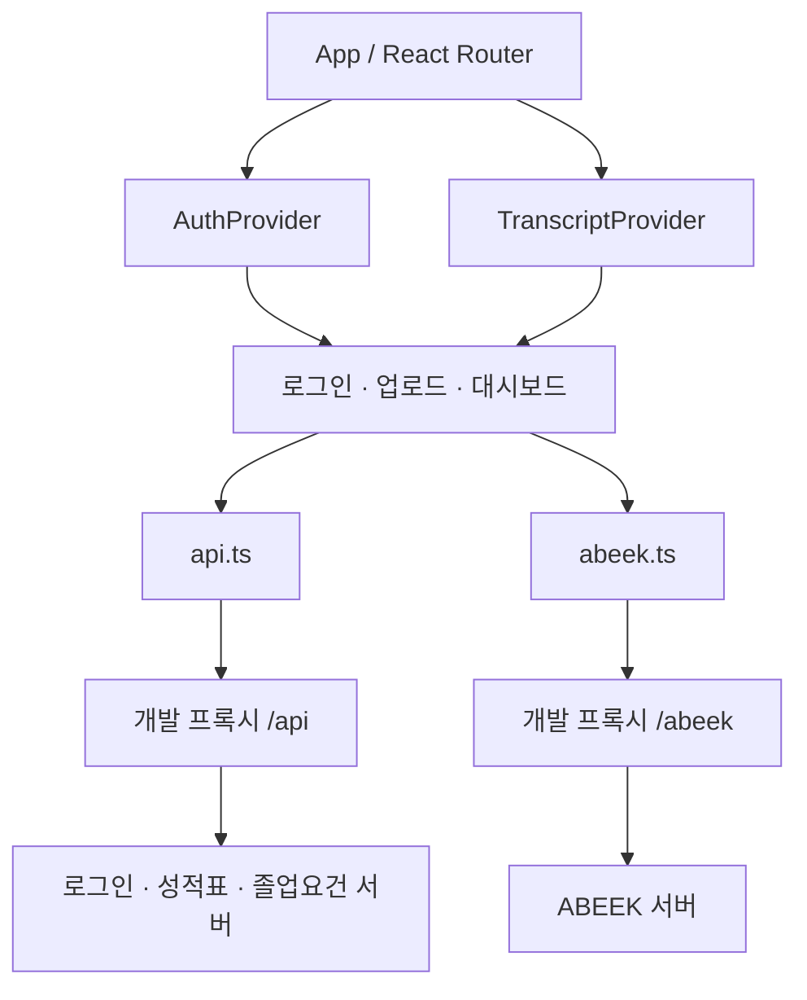

# 프론트엔드 구조와 API 연동

## 책임 분리

프론트엔드는 파일 선택·입력 검증·화면 상태 관리와 분석 결과 표현을 담당합니다. Excel 파싱과 졸업·공학인증 기준 판정은 백엔드의 책임입니다.

## 라우트

| 경로 | 화면 | 접근 |
| --- | --- | --- |
| `/login` | 로그인 | 공개 |
| `/upload` | 성적 Excel 업로드 | 로그인 필요 |
| `/dashboard` | 졸업요건·공학인증·내 이수과목 | 로그인 필요 |
| `/curriculum` | 이수체계도 준비 화면 | 로그인 필요 |

그 외 경로는 `/dashboard`로 이동하며, 로그인 상태가 없으면 `/login`으로 이동합니다.

## API 계약

아래 경로는 프론트엔드 코드가 요청하는 인터페이스입니다. 서버 구현이나 가용성을 보장하는 명세는 아닙니다.

| 서비스 | 메서드 | 서버 경로 | 역할 |
| --- | --- | --- | --- |
| 졸업요건 | POST | `/api/auth/login` | 학생 정보 조회 |
| 졸업요건 | POST | `/api/transcripts/upload/:studentId` | `file` 필드의 multipart Excel 업로드 |
| 졸업요건 | GET | `/api/evaluate/graduation-progress/:studentId` | 졸업 진행도 조회 |
| ABEEK | GET | `/api/departments` | 지원 학과와 별칭 조회 |
| ABEEK | GET | `/api/courses?year=…&department=…` | 학과·연도별 교과목 조회 |
| ABEEK | POST | `/api/evaluate/abeek` | 공학인증 판정 |

개발 환경에서 ABEEK 요청 앞에는 `/abeek`이 붙습니다. Vite 프록시가 이 접두사를 제거한 뒤 ABEEK 서버로 전달합니다. 예: `/abeek/api/departments` → `/api/departments`.

직접 연결 시 `VITE_API_BASE_URL`과 `VITE_ABEEK_API_BASE`는 끝에 `/`가 없는 기준 주소로 설정합니다. 다른 출처의 API는 해당 서버의 CORS 설정도 필요합니다.

## 상태와 데이터 흐름

1. 로그인 응답의 학생 정보를 `AuthProvider`에 저장합니다.
2. 파일 확장자와 크기를 확인한 뒤 `FormData`로 성적표를 업로드합니다.
3. 파싱 결과를 `studentId`와 함께 `TranscriptProvider`에 저장합니다.
4. 졸업요건 탭은 별도 진행도 API의 응답을 시각화합니다.
5. 공학인증 탭은 현재 학생의 성적표를 요청 형식으로 변환하고, 선택한 졸업년도에 따라 판정을 다시 요청합니다.

`transcriptFor`는 로그인한 학생 ID와 저장된 학생 ID가 일치할 때만 성적표를 반환합니다. 이는 브라우저 내 데이터 혼선을 줄이기 위한 처리이며 보안 경계는 아닙니다.

## 실패 상태와 현재 제약

- API 실패는 `ApiError`의 상태 코드와 메시지로 화면에 전달합니다.
- 졸업 진행도 API가 404 또는 500을 반환하면 현재 구현은 성적 업로드로 안내합니다. 서버 오류와 성적 미등록을 구분하는 응답 계약으로 개선할 여지가 있습니다.
- ABEEK 지원 학과 조회가 실패하면 분석 시도를 허용하고, 교과목 조회 실패 시에는 빈 목록으로 대체합니다.
- 과목명 별칭은 ABEEK 응답을 이용해 이수 과목과 매칭합니다. 학기 변환은 현재 성적표 문자열의 숫자를 이용하므로 계절학기 등 추가 형식은 계약 확인이 필요합니다.
- localStorage에 저장된 학생 정보와 성적표는 브라우저를 닫아도 유지됩니다. 현재 로그아웃은 로그인 정보만 제거합니다. 배포 전 보관 정책과 로그아웃 시 성적표 정리를 검토해야 합니다.
- 고전독서·영어·SW 카드의 내용은 정적 예시이며, 실제 인증 결과로 사용할 수 없습니다.

## 검증

GitHub Actions는 `npm ci` → `npm run lint` → `npm run build`를 실행합니다. 서버와 연결한 통합 테스트와 브라우저 E2E 테스트는 아직 포함되어 있지 않습니다.
